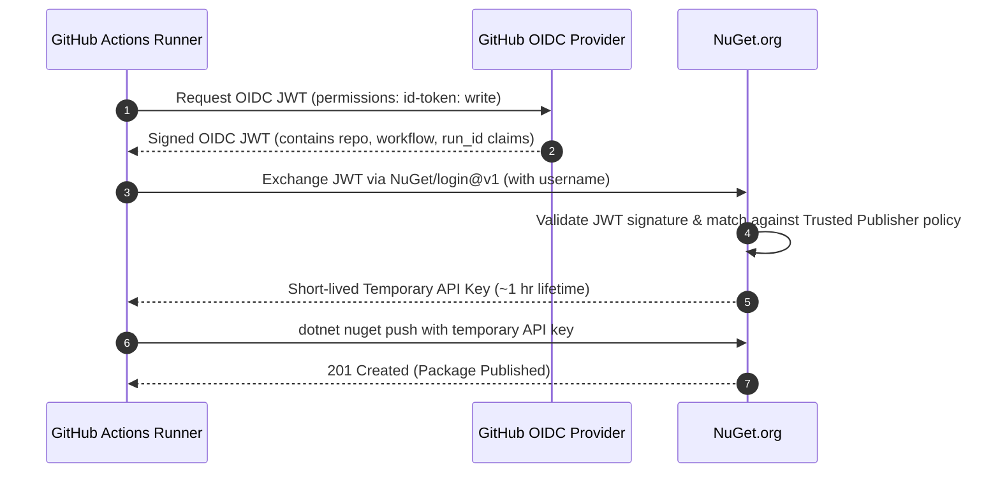

# NuGet Trusted Publishing Architecture & Security Guide

This reference document explains the architecture, security model, and implementation details of keyless Trusted Publishing for NuGet.org.

---

## Why Trusted Publishing?

Historically, publishing NuGet packages from CI/CD required generating a static API key on nuget.org and saving it as a repository secret (such as `NUGET_API_KEY`).

### Problems with Static API Keys:
1. **Long-Lived Credentials**: Keys often had a validity period of 180 to 365 days. If leaked, unauthorized actors could publish malicious packages until revocation.
2. **Key Rotation Friction**: Expired keys break release pipelines unexpectedly, forcing manual rotation across dozens of repositories.
3. **Broad Scope**: Keys were often shared across repositories or multiple packages under an account.

### How OpenID Connect (OIDC) Solves This:
- **No Stored Secrets**: No API keys are persisted in GitHub or CI/CD settings.
- **Just-In-Time Tokens**: GitHub mints a short-lived, cryptographically signed JWT token specifically for the running job.
- **Single-Use & Fast Expiration**: NuGet.org validates the token against the policy and exchanges it for a temporary API key valid for approximately 1 hour.
- **Strict Scope**: The token is cryptographically bound to the specific repository, workflow file, and branch/environment.

---

## Token Exchange Flow

---

## Policy Configuration Fields Explained

When configuring a policy on [nuget.org/account/trustedpublishing](https://www.nuget.org/account/trustedpublishing):

| Field | Description | Critical Notes |
| :--- | :--- | :--- |
| **Policy Name** | Friendly identifier for the policy | Use `<Repository>-publish` preserving the exact case of the repo (e.g., `TNT.Commons-publish`). NuGet policy names are friendly identifiers; matching repository casing provides clear visual parity. |
| **Package Owner** | The NuGet account or organization | Defaults to your personal NuGet account owner (e.g., `ppirtnevets`) or organization. Must match the owner of target packages. |
| **Repository Owner** | GitHub username or organization | E.g., `trippntechnology`. Case-insensitive. |
| **Repository** | GitHub repository name | E.g., `TNT.Commons` or `tnt.commons`. Do not include `.git`. |
| **Workflow File** | The filename of the workflow YAML | **Must be filename only** (e.g. `publish.yml`). Do NOT include `.github/workflows/`. |
| **Environment** | GitHub Environment filter | Leave empty unless your GitHub job specifies `environment: <name>`. |
| **Glob Patterns / Packages** | Package filter pattern | **Must be set to `*`** (asterisk) to allow all packages published by the repository. |

---

## Account-Level vs Package-Level Policies

NuGet.org supports two scopes for Trusted Publishers:

1. **Account/Organization Level** (`nuget.org/account/trustedpublishing`):
   - Grants permission to publish new packages and update existing packages owned by that account.
   - Recommended when multiple packages or new projects are created under the same account.
2. **Package-Level** (`Manage Package` &rarr; `Trusted Publishers`):
   - Scopes trust strictly to a single existing package ID.
   - Recommended when you want least-privilege scoping per package.

---

## Private Repositories & Policy Bootstrapping

For private GitHub repositories:
- Upon initial policy creation, the policy enters a **bootstrapping state** valid for 7 days.
- During the first successful workflow run within that window, NuGet.org captures and binds immutable GitHub IDs (such as the repository ID) to the policy.
- Once bound, the policy is permanently active even if the repository name is changed later.

---

## Why Can't Policy Setup Be Automated via CLI?

NuGet.org intentionally does not expose an external administrative API or CLI commands for creating or modifying Trusted Publishing policies. 

This security boundary ensures that:
- Adding a trusted publisher requires interactive user authentication and multi-factor authentication (MFA) on NuGet.org.
- Compromised CI/CD pipelines or scripts cannot secretly register new trusted publishers or modify policies without human intervention.
